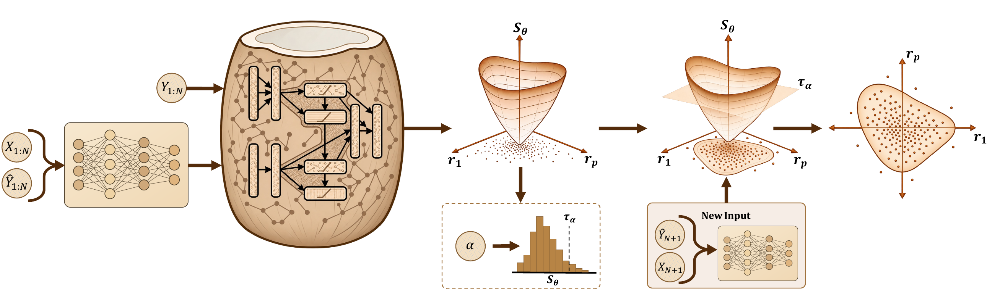

# CoCoNet: Convex Conformal Network for Multi-dimensional Uncertainty Regions

Code, data and fitted artifacts to reproduce the tables of the paper: 25 multivariate datasets
(main table), 6 univariate datasets and the encoder-input ablation (appendix), at 90% target
coverage over seeds 0-4.



Given covariates, point predictions and observed responses, a feature encoder maps the input and
the prediction to an input-dependent representation, which conditions a conformity score that is
convex in the residual. A held-out calibration set determines the conformal threshold at the
chosen miscoverage level. At test time the encoded input conditions the learned score, and its
sublevel set at the threshold is the prediction region: a flexible convex set with a conformal
coverage guarantee.

Two learned convex scores are compared with five baselines. Every method receives the residuals
r = y - F(x) of one frozen MLP point predictor F per (dataset, seed), is calibrated by split
conformal prediction on D_cal and is scored by joint coverage and (mean volume)^(1/p) on D_test.

| Method | `--method` | Set |
|---|---|---|
| CoCoNet_ICNN | `icnn` | sublevel set of an input convex neural network score |
| CoCoNet_Spline | `spline` | rotated hyperrectangle from convex piecewise-linear scores |
| Abs. Res. | `absolute_residual` | hypercube, s = max_j \|r_j\| |
| Emp. Cop. | `empirical_copula` | axis-aligned box, per-coordinate thresholds from the empirical copula |
| G-Ellip. | `global_ellipsoid` | one Mahalanobis ellipsoid |
| L-Ellip. | `local_ellipsoid` | k-nearest-neighbour local covariance ellipsoid |
| MVCS_conv | `mvcs` | convex (p >= 1) minimum-volume covering set of Braun et al. |
| LW-SC | `locally_weighted` | locally weighted split conformal interval (univariate only) |

## Layout

```
run.py                   one method on one dataset (all seeds), writes results/<dataset>/<method>/seed<S>/row.json
fit_point_predictor.py   fit and freeze the MLP point predictor of a dataset (reference/point_predictors has the paper's)
make_table.py            results/ -> tables/ (aggregated.csv, multivariate.tex, univariate.tex); --compare diffs against the paper
configs/paper.yaml       every setting of the paper's protocol
configs/datasets.yaml    the 31 datasets: loader, target columns, row cap, paper row name
coconet/pipeline.py      prepare_data (split, preprocessing, residuals) and the run_<method> functions
coconet/tuning.py        per-(dataset, seed) tuning of the learned scores' optimizer settings
coconet/models/          icnn.py, spline.py (the two scores), mlp.py, volume_estimator.py
coconet/training/        the size + miss + coverage loss, the gamma-grid search, training loops, checkpoint selection
coconet/conformal/       calibration, ellipsoid, empirical_copula, mvcs
coconet/data/            loaders, preprocessing, splits
data/raw/                raw dataset files (UCI/OpenML files are downloaded on first use if missing)
reference/               the paper's frozen point predictors, tuned selections and per-cell numbers (paper_cells.csv)
```

## Setup

Python 3.13 with `pip install -r requirements.txt` (the paper used torch 2.7.1+cu126, numpy 2.3.1,
pandas 2.3.1, scipy 1.16.0, scikit-learn 1.7.0).

## Datasets

All datasets are public regression benchmarks. `n` is the number of rows in the source data,
`d_x` the number of raw input features (before one-hot encoding), `p` the response dimension
and "rows used" the seeded random subsample the paper ran on (`max_rows` in
`configs/datasets.yaml`; "all" when no cap was applied). Rows with a missing target are dropped by
the loader; missing features are median-imputed from D_pred.

### Multivariate (main table)

| Key | Paper name | Domain | Source | n | d_x | p | Rows used |
|---|---|---|---|---:|---:|---:|---:|
| `argoverse2_d2` | Argoverse2-2D | autonomous driving | Argoverse 2 motion forecasting; displacement of the focal agent 6 s ahead from kinematic summaries of its 5 s history | 24,988 | 28 | 2 | 20,000 |
| `argoverse2_motion_forecasting` | Argoverse2 Motion | autonomous driving | same source, 3 s horizon | 24,988 | 28 | 2 | 20,000 |
| `bias_correction_temperature` | Bias-Corr. Temp. | meteorology | UCI 514, next-day (Tmax, Tmin) in Seoul from present-day readings and LDAPS forecasts | 7,723 | 23 | 2 | all |
| `enb` | ENB | building energy | UCI Energy Efficiency (OpenML 41478), heating and cooling load from 8 geometry features | 768 | 8 | 2 | all |
| `geographical_music` | Geographical Music | music geolocation | UCI 315, (latitude, longitude) of a track's origin from 68 audio features | 1,059 | 68 | 2 | all |
| `mvcs_casp` | CASP | structural biology | the MVCS authors' processed CASP arrays (two targets) | 45,730 | 8 | 2 | 20,000 |
| `online_retail_ii` | Online Retail II | retail | UCI 502, (Quantity, Price) of an invoice line from country and invoice date | 1,067,371 | 6 | 2 | 20,000 |
| `qm9_d2` | QM9-2D | quantum chemistry | QM9, first 2 of 12 molecular properties in a fixed order (mu, alpha) | 130,831 | 22 | 2 | 20,000 |
| `household_power_consumption` | Household Power | energy | UCI 235, three sub-metering readings from four whole-house quantities | 2,049,280 | 4 | 3 | 20,000 |
| `scpf` | SCPF | civic services | Mulan "See Click Predict Fix" (OpenML 41487): views, votes, comments of an issue report | 1,137 | 23 | 3 | all |
| `argoverse2_d4` | Argoverse2-4D | autonomous driving | displacements at 3 s and 6 s | 24,988 | 28 | 4 | 20,000 |
| `qm8_excited_states` | QM8 | quantum chemistry | QM8 spectra, the four RI-CC2 quantities (E1, E2, f1, f2) from composition and Coulomb-matrix eigenvalues | 21,786 | 14 | 4 | 20,000 |
| `qm9_d4` | QM9-4D | quantum chemistry | QM9, first 4 properties (+ homo, lumo) | 130,831 | 22 | 4 | 20,000 |
| `sgemm` | SGEMM | computer systems | UCI 440, four repeated run times of a GPU kernel configuration | 241,600 | 14 | 4 | 20,000 |
| `beijing_aq_6d` | Beijing AQ-6D | air quality | UCI 501, six pollutants of one station-hour from its meteorology | 383,980 | 11 | 6 | 20,000 |
| `communities_crime_unnormalized` | Communities Crime | socioeconomic | UCI 211, six per-capita crime rates of a community | 2,215 | 124 | 6 | all |
| `qm9_d6` | QM9-6D | quantum chemistry | QM9, first 6 properties (+ r2, zpve) | 130,831 | 22 | 6 | 20,000 |
| `sarcos` | SARCOS | robotics | SARCOS inverse dynamics, 7 joint torques from the 21-D arm state | 48,933 | 21 | 7 | 20,000 |
| `argoverse2_d8` | Argoverse2-8D | autonomous driving | displacements at 1.5, 3, 4.5 and 6 s | 24,988 | 28 | 8 | 20,000 |
| `qm9_d8` | QM9-8D | quantum chemistry | QM9, first 8 properties (+ Cv, U0) | 130,831 | 22 | 8 | 20,000 |
| `beijing_aq_12d` | Beijing AQ-12D | air quality | UCI 501, PM2.5 of all 12 stations at one hour from every station's meteorology | 35,064 | 76 | 12 | 20,000 |
| `knee_contact_force_d12` | Knee Contact Force | biomechanics | Zenodo 7253458, 12 knee contact-force peaks of a walking trial from subject and trial covariates | 2,786 | 9 | 12 | all |
| `qm7b_d14` | QM7b | quantum chemistry | QM7b, the 14 published molecular properties from Coulomb-matrix eigenvalues and element counts | 7,211 | 29 | 14 | all |
| `oes10` | OES10 | labor statistics | Mulan OES 2010, 16 occupation employment counts per metropolitan area | 403 | 298 | 16 | all |
| `oes97` | OES97 | labor statistics | Mulan OES 1997 | 334 | 263 | 16 | all |

The Argoverse 2 and QM9 tasks of different p are cut from one table each; the columns that are
targets of another variant are removed from the features. For QM9 the property order is
mu, alpha, homo, lumo, r2, zpve, Cv, U0 (then gap, U, H, G, unused here).

### Univariate (appendix)

| Key | Paper name | Domain | Source | n | d_x | Rows used |
|---|---|---|---|---:|---:|---:|
| `beijing_pm25` | Beijing PM2.5 | air quality | UCI 381, hourly PM2.5 from concurrent meteorology | 41,757 | 11 | 10,000 |
| `bike_sharing` | Bike Sharing | transportation | UCI 275, hourly rental count | 17,379 | 12 | 10,000 |
| `ccpp` | CCPP | energy | UCI 294, net power output of a combined-cycle plant | 9,568 | 4 | 10,000 |
| `concrete` | Concrete | civil engineering | UCI concrete compressive strength | 1,030 | 8 | all |
| `kin8nm` | Kin8nm | robotics | OpenML 189, forward kinematics of an 8-link arm | 8,192 | 8 | all |
| `protein` | Protein | structural biology | UCI 265 (CASP), RMSD of a protein structure | 45,730 | 9 | 10,000 |

`data/raw/` ships the raw files exactly as the loaders read them; the UCI and OpenML files are
also downloaded on first use if absent.

## Running

One method on one dataset, all five seeds, with the paper's configuration:

```
python run.py --dataset enb --method icnn --config configs/paper.yaml          # GPU
python run.py --dataset enb --method spline --config configs/paper.yaml        # CPU
python run.py --dataset enb --method mvcs --seeds 0 1                          # CPU, two seeds
python run.py --dataset concrete --method locally_weighted                     # univariate baseline
```

Multivariate datasets take `absolute_residual`, `empirical_copula`, `global_ellipsoid`,
`local_ellipsoid`, `mvcs`, `spline`, `icnn`; univariate ones `absolute_residual`,
`locally_weighted`, `mvcs`, `spline`, `icnn`.

By default a run loads the paper's frozen point predictor and tuned selection for that
(dataset, seed) from `reference/` and checks that this run's data split and residuals are the
ones they were made with. To regenerate them instead:

```
python fit_point_predictor.py --dataset enb --out my_predictors                 # CPU, 4 threads
python run.py --dataset enb --method icnn --point-predictor-dir my_predictors --tuning-dir my_tuning --tune
```

The encoder-input ablation runs the ICNN with `--encoder-input {f,x,none,id_xf,id_x,id_f}`
(`xf` is the paper's CoCoNet_ICNN); the paper reused the production tuning, so keep the default
`--tuning-dir`.

Both scripts default `OMP_NUM_THREADS` to 4 (the paper's CPU setting). For the CPU methods hide
any GPU with `CUDA_VISIBLE_DEVICES=` so torch does not pick it up. A cluster job needs one node,
4 cores, 8 GB per core and, for `icnn`, one GPU.

Tables:

```
python make_table.py             # tables/aggregated.csv, tables/multivariate.tex, tables/univariate.tex
python make_table.py --compare   # plus tables/comparison_with_paper.csv against reference/paper_cells.csv
```

## Reproducing the paper's numbers

The numbers depend on the device, so the paper's device assignment must be kept:

- CoCoNet_ICNN trains and measures its test volume on the GPU. The paper used a Quadro RTX 6000;
  on that card a rerun reproduces the recorded volumes. Another GPU model changes the
  floating-point results and, through the checkpoint and gamma selection steps, can change the
  selected model.
- Everything else (point predictor, baselines, CoCoNet_Spline, MVCS) runs on the CPU with 4
  threads and no GPU visible; those numbers are bit-reproducible. The thread count matters: the
  frozen point predictor's residuals are reproduced only with `OMP_NUM_THREADS=4`.

`reference/paper_cells.csv` lists, for every (dataset, seed, method) of the tables, the volume
and coverage that entered the paper; `make_table.py --compare` diffs a rerun against it. A rerun
of every method on ENB seed 0 (ICNN on a Quadro RTX 6000, the rest on 4 CPU threads), of every
univariate method on Concrete seed 0 and of the global ellipsoid on SGEMM seed 1 reproduced the
recorded volumes and coverages exactly, and refitting the point predictors of ENB and SGEMM
reproduced the recorded residuals bit for bit.

## Protocol (configs/paper.yaml)

Split 25/30/25/20 (D_pred / D_score / D_cal / D_test) from one seeded permutation; large datasets
are first capped to a seeded random sample. Features are standardized / one-hot encoded and
targets standardized with statistics of D_pred only; volumes are reported on the original target
scale.

The learned scores minimise (E[V])^(1/p) + lambda_miss * E[(S - 1)_+] + lambda_cov * (E[sigmoid(10 (1 - S))] - 0.9)^2
on D_score with the threshold fixed at 1, Adam, gradient clipping at 5, at most 400 epochs with
patience 80. The checkpoint is chosen every 5 epochs by calibrated validation coverage and size.
The two weights are gamma multiples of reference scales probed on the initialised model, searched
over gamma_miss in {0.01, 0.03, 1, 10} x gamma_cov in {0, 0.1, 1}; the winner is the
coverage-admissible candidate with the smallest validation size. The ICNN's encoder width
({[64,32], [256,128]}) and the spline's knots {2,4,6,8}, batch size {32,64,128} and encoder width
are tuned per (dataset, seed) at the neutral weights. The ICNN's test volume is the converged
whitened estimator at 2^15 directions (2^14 at p = 1) with a doubling certificate.

MVCS_conv is the fixed-centre convex (p >= 1) MVCS of Braun et al. with the authors' grid (60
candidates, selected by validation objective); the ellipsoids, the copula and LW-SC follow their
papers with the settings listed in the config.

## Citation

If you use this code or the results, please cite the paper:

```bibtex

```
