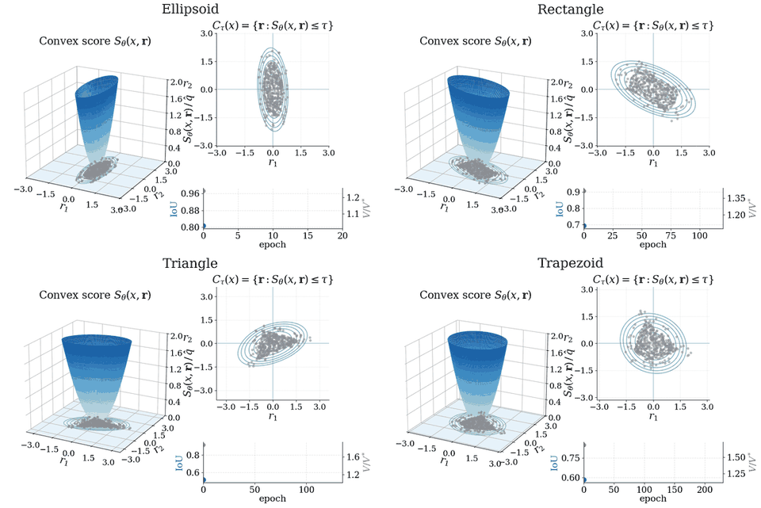
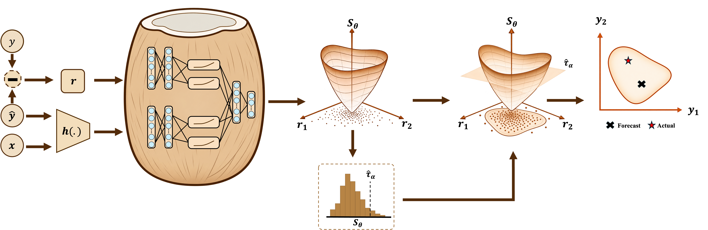

<div align="center">

# CoCoNet 🥥

**Learned convex prediction regions for multivariate regression, with split-conformal coverage**




<sub>The ICNN conformity score (left of each pair) and its 90% prediction region (right) during training on the four synthetic shapes. The dashed outline is the true smallest 90% region; the curves below track IoU and V/V* over the epochs.</sub>

</div>

---

## Overview

CoCoNet learns a **conformity score that is convex in the residual** r = y − F(x). An encoder
maps the input x and the point prediction F(x) to a representation that conditions the score, so
the shape of the region can change with x. A calibration set gives the conformal threshold, and
the sublevel set of the score at that threshold is the prediction region: **convex, input-adaptive,
and covering y with the target probability** under exchangeability.

<p align="center"></p>

Two score families are provided:

- **CoCoNet<sub>ICNN</sub>**: an input-convex neural network. It can represent any convex region,
  including rounded polygons and asymmetric shapes.
- **CoCoNet<sub>Spline</sub>**: convex piecewise-linear scores along learned rotated axes. It
  gives a rotated box with a closed-form volume.

Every method receives the residuals of the **same frozen MLP point predictor** per (dataset,
seed), is calibrated by split conformal prediction on D<sub>cal</sub>, and is scored on
D<sub>test</sub> by joint coverage and size (mean volume)<sup>1/d</sup>.

### What is included

| | |
|---|---|
| 🔷 **Synthetic shapes** | ellipse, rectangle, triangle and trapezoid with a known optimal 90% region |
| 📊 **Multivariate benchmark** | 30 datasets, response dimension d = 2 to 16 |
| 📈 **Univariate benchmark** | 6 datasets |
| ⚖️ **Extended comparison** | MVCS with free exponents, multi-norm MVCS and PBS |

All at 90% target coverage over five seeds. The repository ships code and raw data only: **no
results, fitted models or tuned settings are stored**; every number comes from running the
experiments.

## Methods

| Method | `--method` | Prediction region |
|---|---|---|
| **CoCoNet<sub>ICNN</sub>** | `icnn` | sublevel set of an input-convex neural network score |
| **CoCoNet<sub>Spline</sub>** | `spline` | rotated box from convex piecewise-linear scores |
| Abs. Res. | `absolute_residual` | cube, s = max<sub>j</sub> \|r<sub>j</sub>\| |
| Emp. Cop. | `empirical_copula` | axis-aligned box from the empirical copula of normalized scores |
| G-Ellip. | `global_ellipsoid` | one Mahalanobis ellipsoid |
| L-Ellip. | `local_ellipsoid` | k-nearest-neighbour local covariance ellipsoid |
| MVCS | `mvcs` | convex (q ≥ 1) minimum-volume covering set |
| LW-SC | `locally_weighted` | locally weighted split-conformal interval (univariate only) |

<details>
<summary><b>Extended comparison</b> (multivariate only)</summary>

| Method | `--method` | Prediction region |
|---|---|---|
| MVCS, free q | `mvcs_free` | the same set with a free exponent (q ≥ 0.1, not convex when q < 1) |
| MVCS multi-norm, q ≥ 1 | `mvcs_multi` | one global set: a scaled q<sub>j</sub>-norm ball per orthant after a rotation, every q<sub>j</sub> ≥ 1 |
| MVCS multi-norm, free q | `mvcs_multi_free` | the same with free exponents |
| PBS | `pbs` | pullback of a Euclidean ball through a conditional neural optimal-transport map |

The two multi-norm variants run the MVCS authors' own code. Fetch it once with
`bash scripts/get_mvcs.sh`, which clones their public repository at a fixed commit into
`third_party/`.

</details>

## Installation

```bash
pip install -r requirements.txt
bash scripts/get_mvcs.sh        # only for mvcs_multi / mvcs_multi_free
```

Python 3.13. The reported numbers were produced with torch 2.7.1+cu126, numpy 2.3.1,
pandas 2.3.1, scipy 1.16.0 and scikit-learn 1.7.0. Raw data live in `data/raw/`; UCI and OpenML
files that are missing are downloaded on first use.

## Quick start

Each command runs **one method on one dataset or shape**, for every seed or for the seeds you
give, and writes one folder per seed with its `row.json`.

```bash
# real data: results/<dataset>/<method>/seed<S>/row.json
python run.py --dataset enb --method icnn                     # seeds 0-4
python run.py --dataset enb --method spline --seeds 0 1
python run.py --dataset concrete --method locally_weighted    # univariate baseline

# synthetic shapes: results_synthetic/<shape>/<method>/seed<S>/row.json
python synthetic.py --shape triangle --method icnn            # seeds 42-46
python synthetic.py --shape rectangle --method mvcs
```

Each `row.json` holds the test coverage, the mean volume and its size (mean V)<sup>1/d</sup>,
the conformal threshold and the data hashes, plus the selected loss weights and checkpoint for the learned scores.
`--help` on either script lists every flag.

## Experiments

### 🔷 Synthetic shapes

Four 2-D residual laws whose smallest 90% region is known exactly (`coconet/data/synthetic.py`).
The residual is uniform in a convex body B with probability 0.9 and uniform in the shell
1.6 B \ B otherwise, then rotated and scaled. The core is 14 times denser than the shell, so B
itself is the unique smallest region with 90% coverage; its area is V\*. The input x is uniform
on [−1, 1]<sup>2</sup>, and every method is given the exact mean as its point prediction.

| | |
|---|---|
| **Shapes** | `ellipse`, `rectangle`, `triangle`, `trapezoid` |
| **Methods** | `absolute_residual`, `empirical_copula`, `global_ellipsoid`, `local_ellipsoid`, `mvcs`, `spline`, `icnn` |
| **Splits per seed** | 2,500 train · 2,000 validation · 8,000 calibration · 1,000 test |
| **Seeds** | 42–46 |
| **Metrics** | test coverage · V/V\* (mean region area over V\*) · IoU with the true region |

IoU compares the region at an input with the true region on a 500 × 500 grid, averaged over
x = (0, 0) and 24 random inputs. The settings that differ from the real-data runs are in the
`synthetic` block of `configs/experiment.yaml`: γ<sub>cov</sub> ∈ {0, 0.1}, and a fixed ICNN
(learning rate 0.002, batch size 32, encoder [64, 32]). The spline is tuned as on real data.

### 📓 Notebook

`synthetic.ipynb` runs the synthetic experiment from start to finish and is shipped with its outputs, so the
results and the figure can be read without running anything.

| Step | What it does |
|---|---|
| **Settings** | shapes, methods and seeds; by default one seed per shape (the figure seeds), or all five with `SEEDS = [42, 43, 44, 45, 46]` |
| **1. Run** | every method on every shape through `synthetic.py`; finished runs are not repeated and their saved result is shown |
| **2. Results** | test coverage, V/V\* and IoU of every run |
| **3. Figure** | the calibrated 90% regions of CoCoNet<sub>ICNN</sub>, MVCS, CoCoNet<sub>Spline</sub> and L-Ellip. against the true region, saved as `results_synthetic/synthetic_regions.pdf` |

```bash
jupyter notebook synthetic.ipynb
```

The figure alone is `python plot_synthetic.py`. It reads the `region.npz` file that each run saves (the
method's score at x = (0, 0) on the IoU grid).

### 📊 Real data

```bash
python run.py --dataset <key> --method <method>
```

Multivariate datasets take `absolute_residual`, `empirical_copula`, `global_ellipsoid`,
`local_ellipsoid`, `mvcs`, `spline`, `icnn` and the four extended methods. Univariate datasets
take `absolute_residual`, `locally_weighted`, `mvcs`, `spline` and `icnn`.

> **End to end.** Each run fits the MLP point predictor of the (dataset, seed) and, for `icnn`
> and `spline`, first tunes their settings. The tuned choice is saved in `<output-dir>/tuning/`
> with a hash of the data split and residuals, and later runs of the same (dataset, seed) reuse
> it. Tuning is the expensive step: a few extra trainings per (dataset, seed). To share
> point predictors across runs, save them once with
> `python fit_point_predictor.py --dataset enb --out my_predictors` and pass
> `--point-predictor-dir my_predictors`.

> **Volumes.** By default each baseline reports the closed-form volume of its region. The
> reported multivariate volumes instead measure every region with the same Monte Carlo
> estimator the ICNN uses (per test point, groups of 30 points, 2<sup>15</sup> directions,
> doubling until the size changes by less than 0.1%). Add `--volume estimator` to do the same.
> PBS always reports its own change-of-variables volume, and univariate intervals are exact.

## Reproducibility

The CoCoNet<sub>ICNN</sub> results were produced on a Quadro RTX 6000.

## Protocol

All settings live in `configs/experiment.yaml`; the datasets are defined in `configs/datasets.yaml`.

| Stage | Setting |
|---|---|
| **Data split** | D<sub>pred</sub> / D<sub>score</sub> / D<sub>cal</sub> / D<sub>test</sub> = 25 / 30 / 25 / 20% from one seeded permutation; large datasets are first capped to a seeded random sample |
| **Preprocessing** | features standardized and one-hot encoded, targets standardized, all with statistics of D<sub>pred</sub>; volumes are reported on the original target scale |
| **Point predictor** | MLP [64, 32] fitted on D<sub>pred</sub> and frozen; every method uses its residuals |
| **Objective** | (mean V)<sup>1/d</sup> + λ<sub>miss</sub> · mean[(S − 1)<sub>+</sub>] + λ<sub>cov</sub> · (mean σ(10 (1 − S)) − 0.9)<sup>2</sup>, threshold fixed at 1 |
| **Optimisation** | Adam, gradient clipping at 5, patience 80; at most 400 epochs (ICNN) or 300 (spline) |
| **Loss weights** | λ = γ × reference scale of the initialised model; γ<sub>miss</sub> ∈ {0.01, 0.03, 1, 10} × γ<sub>cov</sub> ∈ {0, 0.1, 1}; the coverage-admissible candidate with the smallest validation size wins |
| **Checkpoint** | every 5 epochs, by calibrated validation coverage and size |
| **Tuning** | per (dataset, seed), at the neutral weights: the ICNN encoder width {[64, 32], [256, 128]}; the spline knots {2, 4, 6, 8}, batch size {32, 64, 128} and encoder width |
| **Calibration** | split conformal on D<sub>cal</sub>, 90% target coverage |
| **ICNN volume** | whitened Monte Carlo estimate at M = 2<sup>15</sup> and 2M = 2<sup>16</sup> directions in one pass, 2<sup>16</sup> reported; converged when doubling changes the size by less than 0.1%; at d = 1 the exact interval length |

| Baseline | Setting |
|---|---|
| **MVCS** | the authors' hyperparameter grid (60 candidates, selected by validation objective); q ≥ 1 (`mvcs`) or q = max(\|q\|, 0.1) (`mvcs_free`) |
| **Multi-norm MVCS** | the authors' code and defaults with two splits; the convex variant projects every exponent onto q ≥ 1 after each step |
| **PBS** | the five network configurations in the config; the one with the smallest validation coverage error of its plug-in sets is kept |
| **Ellipsoids, copula, LW-SC** | the settings listed in the config |

## Datasets

`n` is the number of rows in the source data after rows with a missing target are dropped, `d_x`
the number of input features after preprocessing (constant columns dropped, categorical
columns one-hot encoded; seed 0), `d` the response dimension, and
"rows used" the number of rows the experiments run on: a seeded random subsample when the
source has more rows than `max_rows` in `configs/datasets.yaml`, otherwise all of them. Missing features are median-imputed from D<sub>pred</sub>. The encoder
is fitted on D<sub>pred</sub>, so the number of one-hot columns can change with the seed: 36 to 42
for Online Retail II and 60 to 61 for Bike Sharing.

<details>
<summary><b>Multivariate: 30 datasets, d = 2 to 16</b></summary>

| Key | Label | Source | n | d_x | d | Rows used |
|---|---|---|---:|---:|---:|---:|
| `argoverse2_2d` | Argoverse2-2D | Argoverse 2 motion forecasting: displacement of the focal agent 6 s ahead from summaries of its 5 s history | 24,988 | 28 | 2 | 20,000 |
| `argoverse2_motion` | Argoverse2 Motion | same source, 3 s horizon | 24,988 | 28 | 2 | 20,000 |
| `bias_corr_temp` | Bias-Corr. Temp. | UCI 514: next-day (Tmax, Tmin) from present-day readings and forecasts | 7,723 | 46 | 2 | all |
| `enb` | ENB | UCI Energy Efficiency (OpenML 41478): heating and cooling load | 768 | 8 | 2 | all |
| `geographical_music` | Geographical Music | UCI 315: (latitude, longitude) of a track from 68 audio features | 1,059 | 68 | 2 | all |
| `casp` | CASP | processed CASP arrays, two targets | 45,730 | 8 | 2 | 20,000 |
| `online_retail_ii` | Online Retail II | UCI 502: (Quantity, Price) of an invoice line from country and date | 1,067,371 | 42 | 2 | 20,000 |
| `qm9_2d` | QM9-2D | QM9: first 2 of 12 molecular properties (mu, alpha) | 130,831 | 22 | 2 | 20,000 |
| `household_power` | Household Power | UCI 235: three sub-metering readings from four whole-house quantities | 2,049,280 | 4 | 3 | 20,000 |
| `scpf` | SCPF | See Click Predict Fix (OpenML 41487): views, votes, comments of an issue report | 1,137 | 23 | 3 | all |
| `argoverse2_4d` | Argoverse2-4D | displacements at 3 s and 6 s | 24,988 | 28 | 4 | 20,000 |
| `qm8` | QM8 | QM8 spectra: the four RI-CC2 quantities from composition and Coulomb-matrix eigenvalues | 21,786 | 14 | 4 | 20,000 |
| `qm9_4d` | QM9-4D | QM9: first 4 properties (+ homo, lumo) | 130,831 | 22 | 4 | 20,000 |
| `sgemm` | SGEMM | UCI 440: four repeated run times of a GPU kernel configuration | 241,600 | 18 | 4 | 20,000 |
| `beijing_aq_6d` | Beijing AQ-6D | UCI 501: six pollutants of one station-hour from its meteorology | 383,980 | 37 | 6 | 20,000 |
| `communities_crime` | Communities Crime | UCI 211: six per-capita crime rates of a community | 1,990 | 124 | 6 | all |
| `atp1d` | ATP1D | Mulan ATP1D (OpenML 41475): next-day minimum price of six flight/fare combinations from price-quote history | 337 | 370 | 6 | all |
| `qm9_6d` | QM9-6D | QM9: first 6 properties (+ r2, zpve) | 130,831 | 22 | 6 | 20,000 |
| `sarcos` | SARCOS | SARCOS inverse dynamics: 7 joint torques from the 21-D arm state | 48,933 | 21 | 7 | 20,000 |
| `argoverse2_8d` | Argoverse2-8D | displacements at 1.5, 3, 4.5 and 6 s | 24,988 | 28 | 8 | 20,000 |
| `qm9_8d` | QM9-8D | QM9: first 8 properties (+ Cv, U0) | 130,831 | 22 | 8 | 20,000 |
| `beijing_aq_12d` | Beijing AQ-12D | UCI 501: PM2.5 of all 12 stations at one hour from every station's meteorology (hours with all 12 readings) | 28,663 | 256 | 12 | 20,000 |
| `knee_contact_force` | Knee Contact Force | Zenodo 7253458: 12 knee contact-force peaks of a walking trial | 2,786 | 12 | 12 | all |
| `wq` | WQ | Mulan water quality (OpenML 41491): 14 species and indicator concentrations from 16 physico-chemical measurements | 1,060 | 16 | 14 | all |
| `qm7b` | QM7b | QM7b: the 14 molecular properties from Coulomb-matrix eigenvalues and element counts | 7,211 | 29 | 14 | all |
| `oes10` | OES10 | OES 2010: 16 occupation employment counts per metropolitan area | 403 | 298 | 16 | all |
| `oes97` | OES97 | OES 1997 | 334 | 263 | 16 | all |
| `bdg2_fox` | BDG2-Fox | Building Data Genome 2, site Fox: hourly electricity of 16 buildings from site weather and calendar features | 17,537 | 12 | 16 | all |
| `bdg2_eagle` | BDG2-Eagle | same, site Eagle | 17,105 | 12 | 16 | all |
| `bdg2_lamb` | BDG2-Lamb | same, site Lamb | 17,544 | 10 | 16 | all |

The Argoverse 2 and QM9 tasks of different d are cut from one table each; the columns that are
targets of another variant are removed from the features. QM9 properties are taken in the order
mu, alpha, homo, lumo, r2, zpve, Cv, U0 (then gap, U, H, G, unused).
</details>

<details>
<summary><b>Univariate: 6 datasets</b></summary>

| Key | Label | Source | n | d_x | Rows used |
|---|---|---|---:|---:|---:|
| `beijing_pm25` | Beijing PM2.5 | UCI 381: hourly PM2.5 from concurrent meteorology | 41,757 | 14 | 10,000 |
| `bike_sharing` | Bike Sharing | UCI 275: hourly rental count | 17,379 | 60 | 10,000 |
| `ccpp` | CCPP | UCI 294: net power output of a combined-cycle plant | 9,568 | 4 | all |
| `concrete` | Concrete | UCI concrete compressive strength | 1,030 | 8 | all |
| `kin8nm` | Kin8nm | OpenML 189: forward kinematics of an 8-link arm | 8,192 | 8 | all |
| `protein` | Protein | UCI 265 (CASP): RMSD of a protein structure | 45,730 | 9 | 10,000 |
</details>

## Repository layout

```
├── run.py                   one method on one real dataset  → results/<dataset>/<method>/seed<S>/row.json
├── synthetic.py             one method on one synthetic shape → results_synthetic/<shape>/<method>/seed<S>/
├── synthetic.ipynb          the synthetic experiment step by step: runs, per-run results, figure
├── plot_synthetic.py        the figure of synthetic regions, from the saved runs
├── fit_point_predictor.py   fit and save the MLP point predictor of a dataset
├── configs/
│   ├── experiment.yaml      every setting of the experiments
│   └── datasets.yaml        the 36 datasets: loader, target columns, row cap
├── coconet/
│   ├── pipeline.py          data preparation, one run_<method> per method, evaluation
│   ├── tuning.py            per-(dataset, seed) tuning of the learned scores
│   ├── models/              icnn.py, spline.py (the two scores), mlp.py, volume_estimator.py
│   ├── training/            loss, loss-weight grid search, training loop, checkpoint selection
│   ├── conformal/           calibration, ellipsoids, empirical copula, MVCS (single and multi-norm), PBS
│   └── data/                loaders, preprocessing, splits, synthetic shapes
├── scripts/get_mvcs.sh      fetches the MVCS authors' code used by the multi-norm baselines
└── data/raw/                raw dataset files
```
